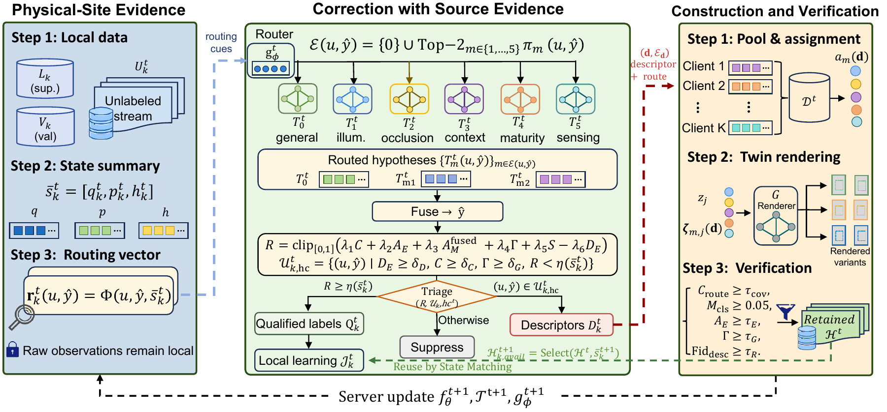

# TE-Fed V2.6

[](https://docs.astral.sh/uv/)

[](LICENSE)


Code for **TE-Fed: Correction with Source Evidence and Reuse by State Matching for Federated Semi-Supervised Multisensor Object Detection**. Current package version: **2.6.1**.

[V2.6 changes](docs/CHANGELOG.md)

[Manuscript alignment](docs/MANUSCRIPT_ALIGNMENT.md) · [Audit and analysis tools](docs/ANALYSIS_TOOLS.md)

<p align="center">
  
</p>

> [!IMPORTANT]
> This repository contains TE-Fed training, calibration, rendering, evaluation and analysis code. Datasets, trained weights and manuscript result records are not included.

# Getting Started

## uv

Install the CPU development environment with Python 3.12:

```bash
uv sync --locked --extra cpu

uv run --locked --extra cpu python -m tefed.main --help
uv run --locked --extra cpu python -m tefed.main methods
```

For the RTX 5080 server and Jetson Orin Nano Super clients, use the separate [GPU environments](docs/HARDWARE.md). Follow [Getting Started](docs/GETTING_STARTED.md#actual-data-experiments) to prepare data, a shared initial checkpoint, calibration and Blender assets.

## Docker

```bash
docker build -t tefed:cpu .
docker run --rm tefed:cpu methods
docker run --rm tefed:cpu --help
```

The Dockerfile defines a CPU development image. Build and execution status are recorded in [ENVIRONMENT.md](docs/ENVIRONMENT.md).

# Configuration

See [executable workflows](docs/WORKFLOWS.md) for round recovery, frozen-pool replay, eight-cell execution and client workers.

Hyperparameters and paths are managed with TOML files in [configs/](configs). Copy a dataset configuration to `configs/local.toml` and set the local data, calibration, initialization and scene paths.

```bash
python -m tefed.main tefed --config configs/local.toml --seed 0 --output runs/tefed-seed0
```

Run the command in the configured GPU environment. CPU runs use `experiment.device = "cpu"` and the `uv run --locked --extra cpu` prefix. The [setup guide](docs/GETTING_STARTED.md#actual-data-experiments) includes initialization, calibration and the private `TEFED_SOURCE_SECRET`.

```bash
python scripts/run_suite.py --config configs/local.toml --plan comparisons --output runs/comparisons
```

Add `--execute` to run the comparison plan. Documentation: [experiment index](docs/EXPERIMENT_INDEX.md) · [method](docs/METHOD_CONTRACT.md) · [implementation choices](docs/IMPLEMENTATION_CHOICES.md) · [executed checks](docs/TEST_REPORT.md).

# Citation

Software metadata is provided in [CITATION.cff](CITATION.cff). To cite TE-Fed:

```bibtex
@software{tefed_2026,
  author  = {Sun, Pinghan and Jin, Wenquan},
  title   = {{TE-Fed}: Correction with Source Evidence and Reuse by State Matching
             for Federated Semi-Supervised Multisensor Object Detection},
  year    = {2026},
  version = {2.6.1}
}
```

License: [AGPL-3.0-only](LICENSE). Dependency terms are described in [THIRD_PARTY.md](THIRD_PARTY.md).

