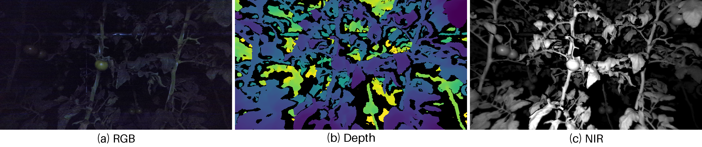

# RGB, depth and NIR input example

This example contains three corresponding input files from the same lighting folder and image number: RGB, depth, and near-infrared (NIR). The source folder is `微弱光` (low illumination), image `1.png`.



## Rebuild the preview

From the repository root, install the base dependencies and choose a new output directory:

```bash
uv sync --locked
uv run --locked python -m tefed preview --example examples/tomato_trimodal --output runs/tomato_preview
```

This command reads the three original images and the fixed display settings in `manifest.json`. It saves `rgb.png`, `depth_display.png`, `nir_display.png`, `rgb_depth_nir.png`, and `preview.json`. No checkpoint, PyTorch, or model inference is required.

| Modality | Original file | Display image |
|---|---|---|
| RGB | [8-bit RGB](inputs/rgb.png) | [RGB](images/rgb.png) |
| Depth | [16-bit PNG](inputs/depth.png) | [Depth display](images/depth_display.png) |
| NIR | [16-bit PNG](inputs/nir.png) | [NIR display](images/nir_display.png) |

The original PNG files are preserved without changing pixel values. RGB is copied byte for byte. Depth and NIR use the fixed global display limits recorded in [manifest.json](manifest.json), originally obtained from the 1st and 99th percentiles of their positive pixel values. Values are clipped to these limits and rounded to 8-bit display indices; depth uses the bundled [viridis palette](display_palette.json), and NIR uses grayscale. Zero values are shown in black. Physical distance units are not assigned to the depth colors in this preview.

Use the original files in `inputs/` for data processing. The 8-bit images in `images/` are for viewing. Pairing follows the existing project's condition-and-filename rule; this example does not independently verify acquisition timestamps or assign a Hard-test identity.

## Model inference

For predictions rather than an input preview, see [single-sample inference](../../docs/single_sample_inference.md). It requires your own compatible TE-Fed checkpoint, frozen calibration, and a client state from the checkpoint. Prepare NIR using the fixed training preprocessing: the current model reader does not accept the bundled raw 16-bit NIR directly. Do not use the display mapping as a substitute.

Data reference: Zhang et al., *A dataset of multimodal images of tomato fruits at different stages of maturity*, China Scientific Data (2025). [Dataset paper](https://doi.org/10.11922/11-6035.csd.2023.0154.zh).
